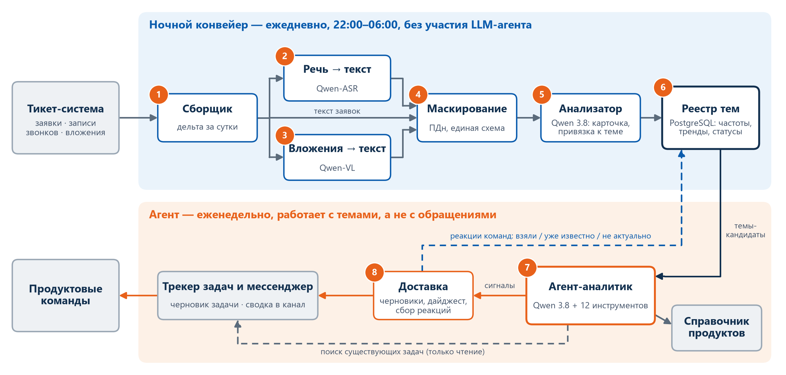

# ИИ-агент «Сигнал»

Решение задания #1 по треку «Искусственный интеллект»: ИИ-агент, который собирает обращения в техподдержку, находит регулярно повторяющиеся просьбы пользователей и сообщает о них продуктовым командам, не нагружая поддержку.

**Команда Claude’s boys:** Стабровский Александр, Третьяков Кирилл, Проворов Илья.



## Суть решения

- **Агент работает с темами, а не с тикетами.** Поток обращений (≈1 000 в день) сжимает ночной конвейер на внутренних моделях Qwen-ASR, Qwen-VL и Qwen 3.8. LLM-агент с инструментами включается раз в неделю и проверяет 30–50 тем, а командам уходит 5–10 подтверждённых сигналов с цифрами и цитатами.
- **8 микросервисов**, у каждого своя причина быть отдельным. Вся обработка — ≈3,5 GPU-часа за ночь из восьми доступных.
- **12 инструментов с минимальными правами.** Источники — только чтение, запись — в свой реестр и в черновики задач; цифры в сигнал подставляет шаблон, а не модель.
- **Пять уровней проверки до релиза:** компоненты, сценарии агента, ретротест по архиву за год, теневой режим, пилот.
- **Метрики по цепочке эффекта:** время до сигнала, принятие сигналов, результат исправлений, поток обращений, ручные выгрузки.
- **Финансы:** при окупаемости за 3 года допустимые вложения — 12,8 / 25,1 / 39,9 млн ₽ (пессимистичный, базовый, оптимистичный сценарии). Рекомендация — начать с текстовых заявок и уложиться в 12,8 млн ₽.

## Файлы

| Файл | Что внутри |
|---|---|
| [Основное_решение_ИИ-агент_Сигнал.docx](Основное_решение_ИИ-агент_Сигнал.docx) ([pdf](Основное_решение_ИИ-агент_Сигнал.pdf)) | Ответы на вопросы 1–4 и 6: архитектура, инструменты, промпт, тестирование, финансовая модель |
| [Пункт_5_Метрики_эффекта.md](Пункт_5_Метрики_эффекта.md) | Вопрос 5: метрики успеха, сбор базовой линии, отслеживание, запасные варианты |
| [Презентация_Сигнал.pptx](Презентация_Сигнал.pptx) ([pdf](Презентация_Сигнал.pdf)) | Сопроводительная презентация, 10 слайдов с заметками докладчика |
| [AI_Footnotes.docx](AI_Footnotes.docx) | Приложение: где и как использовался ИИ |
| [Промпты_решения_кейса.md](Промпты_решения_кейса.md) ([docx](Промпты_решения_кейса.docx)) | Промпты к ИИ по шагам решения |
| [model/finance_model.py](model/finance_model.py) | Финансовая модель: эффект по годам, приведённая стоимость, чувствительность к ставке |
| [model/architecture_diagram.py](model/architecture_diagram.py) | Генератор схемы архитектуры |

## Как проверить расчёты

```bash
python model/finance_model.py
```

Скрипт печатает эффект по годам и приведённую стоимость для трёх сценариев. Цифры совпадают с разделом 6 основного решения.

Источники макроданных: Банк России — решение по ключевой ставке и среднесрочный прогноз от 23.10.2026; Росстат — заработная плата, январь–июль 2026.
